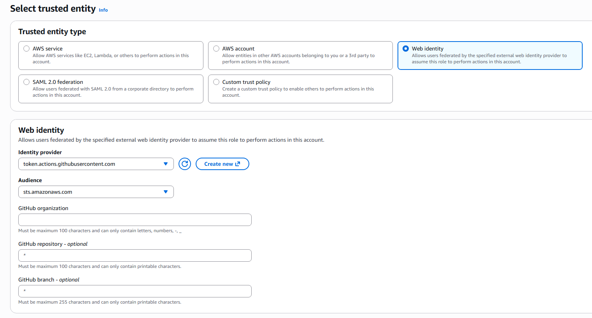
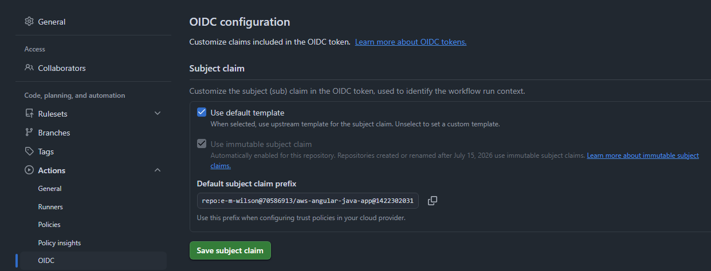

# AWS deployment

The GitHub Actions workflows deploy the Angular site to S3 and the Spring Boot container to ECS Fargate when changes reach `main`. They assume the AWS resources below already exist; these workflows do not create infrastructure. This entire folder including: .gihub, backend, & frontend are assumed to be at the root of a github repo. In these shared files, they are obviously nested under other folders in a larger repo, among our class resources instead.

## AWS resources

- A private S3 bucket for the Angular build, with CloudFront configured as its origin using Origin Access Control.
- A CloudFront distribution whose default behavior serves the S3 site and whose `/api/*` behavior forwards to the backend Application Load Balancer. Forward cookies and the `X-XSRF-TOKEN` header, allow the required API methods, and use HTTPS to the ALB.
- An ECR repository, an ECS Fargate cluster and service, and an Application Load Balancer target group forwarding to container port `8080`.
- A CloudWatch log group named `/ecs/aws-angular-java-app`.
- A Secrets Manager JSON secret containing `SPRING_DATASOURCE_URL`, `SPRING_DATASOURCE_USERNAME`, and `SPRING_DATASOURCE_PASSWORD` for the production database.
- An ECS task execution role that can pull from ECR, write to the log group, and read the database secret. If the secret uses a customer-managed KMS key, allow decrypting that key too.
- A GitHub Actions OIDC IAM role trusted only for this repository's `main` branch. Grant it permission to upload/delete objects in the frontend bucket, create CloudFront invalidations, push to the ECR repository, register ECS task definitions, update the ECS service, describe deployments, and pass the ECS task execution role.

The CloudFront `/api/*` behavior is important: the frontend calls `/api` on its own origin so session and CSRF cookies remain same-origin. Route `/api/*` to the ALB and do not cache API responses. Configure the ALB target group's health check for an endpoint the application permits.

For client-side routes, configure CloudFront's S3-origin responses to serve `/index.html` via functions, keep these fallback rules scoped to the S3 origin, not the API behavior.

## GitHub repository variables

Set these under **Settings > Secrets and variables > Actions > Variables**:

| Variable | Value |
| --- | --- |
| `AWS_REGION` | AWS region containing these resources |
| `AWS_ROLE_ARN` | ARN of the GitHub OIDC deployment role |
| `FRONTEND_BUCKET` | S3 bucket name for the Angular site |
| `CLOUDFRONT_DISTRIBUTION_ID` | CloudFront distribution ID |
| `ECR_REPOSITORY` | ECR repository name |
| `ECS_CLUSTER` | ECS cluster name |
| `ECS_SERVICE` | ECS service name |
| `ECS_TASK_EXECUTION_ROLE_ARN` | ECS task execution role ARN |
| `DATABASE_SECRET_ARN` | ARN of the JSON database secret |
| `DB_HOST` | URL for the RDS SQL server |

No AWS access keys are stored in GitHub. The workflows assume the OIDC role at runtime. The ECS task execution role, not GitHub, reads the database secret.

## Workflows

- `.github/workflows/frontend-deploy.yml` builds `frontend` and syncs `dist/student_management/browser` to S3, then invalidates CloudFront.
- `.github/workflows/backend-deploy.yml` tests `backend`, builds and pushes a SHA-tagged image, and deploys a new task definition to the ECS service.

Both can also be started manually with **Actions > Run workflow**. The task definition starts with 0.5 vCPU and 1 GB memory; adjust `backend/ecs-task-definition.json` to match the service's capacity needs.


## Creating AWS_ROLE_ARN:

### We first need an identity provider setup in IAM
1. Navigate to IAM > Identity Providers > Add Provider
2. Options: 
- Provider Type: OpenID Connect
- Provider URL: https://token.actions.githubusercontent.com
- Audience:  sts.amazonaws.com

### Now we can create the role.
1. Navigate to IAM > Roles > Create Role 
2. Options:

- For 'GitHub repository' as seen above, you need to get the subject claim prefix from GitHub, as seen here in the repo settings menu: 



Your trust policy should look something like this:
```
{
    "Version": "2012-10-17",
    "Statement": [
        {
            "Effect": "Allow",
            "Principal": {
                "Federated": "arn:aws:iam::<YOUR_ACCOUNT_ID>:oidc-provider/token.actions.githubusercontent.com"
            },
            "Action": "sts:AssumeRoleWithWebIdentity",
            "Condition": {
                "StringEquals": {
                    "token.actions.githubusercontent.com:aud": "sts.amazonaws.com",
                    "token.actions.githubusercontent.com:sub": "repo:e-m-wilson@70586913/aws-angular-java-app@1422302031:ref:refs/heads/main"
                }
            }
        }
    ]
}
```

Permissions for the role used by our workflow to update ECR, ECS, S3, & CloudFront (Note that many permissions are global scoped with '*' under 'Resource' - this is NOT ideal. Note how the S3 permissions in comparision are scoped to a single S3 bucket):
```
{
    "Version": "2012-10-17",
    "Statement": [
        {
            "Sid": "VisualEditor0",
            "Effect": "Allow",
            "Action": [
                "ecs:PutAttributes",
                "ecs:UpdateCluster",
                "ecs:ListAttributes",
                "ecs:DescribeTaskSets",
                "ecr:UploadLayerPart",
                "ecr:ListImages",
                "cloudfront:CreateInvalidation",
                "ecs:DescribeTaskDefinition",
                "ecs:ListServices",
                "ecs:DeregisterTaskDefinition",
                "ecs:UpdateService",
                "iam:PassRole",
                "ecs:ListTasks",
                "ecs:RegisterTaskDefinition",
                "ecr:CompleteLayerUpload",
                "ecs:DescribeServiceDeployments",
                "ecs:DescribeServices",
                "ecs:DescribeContainerInstances",
                "ecs:DescribeTasks",
                "ecr:BatchCheckLayerAvailability",
                "ecs:ListTaskDefinitions",
                "ecs:UpdateClusterSettings",
                "ecr:GetDownloadUrlForLayer",
                "ecr:GetAuthorizationToken",
                "ecr:PutImage",
                "ecs:DescribeClusters",
                "ecs:ListTaskDefinitionFamilies",
                "ecr:DescribeImages",
                "ecs:ListContainerInstances",
                "ecr:InitiateLayerUpload",
                "ecr:GetRepositoryPolicy"
            ],
            "Resource": "*"
        },
        {
            "Sid": "VisualEditor1",
            "Effect": "Allow",
            "Action": "s3:ListBucket",
            "Resource": "arn:aws:s3:::rev-angular-site"
        },
        {
            "Sid": "VisualEditor2",
            "Effect": "Allow",
            "Action": [
                "s3:PutObject",
                "s3:DeleteObject"
            ],
            "Resource": "arn:aws:s3:::rev-angular-site/*"
        }
    ]
}
```