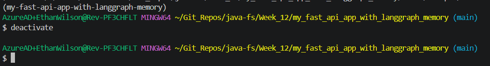

# Student API

A FastAPI service for creating students in PostgreSQL and retrieving them by ID or name.

## Configure PostgreSQL

The app expects your PostgreSQL container to be available on `localhost:5432`
with the `student_tracker` database. Copy `.env.example` to `.env` and set
`DATABASE_URL` to match the credentials you used when starting the container:

```text
DATABASE_URL=postgresql+psycopg://postgres:<your-password>@localhost:5432/student_tracker
```

Starting Postgres in the docker container:
```
docker run --name python-postgres -e POSTGRES_USER=postgres -e POSTGRES_PASSWORD=Password123! -e POSTGRES_DB=student_tracker -p 5432:5432 -d postgres:17
```

The student-question endpoint sends the current student IDs and names to Ollama
as context. By default, Ollama must be running on the same machine at
`http://localhost:11434` with the `lfm3` model available. Change `OLLAMA_MODEL`
or `OLLAMA_BASE_URL` in `.env` if needed. Student data is sent to the configured
Ollama server, so keep the base URL pointed at a server you trust.

## Run the app

Before running uv commands, just note that you don't want to run them from within your venv. Some vscode plugins will try to automatically start your venv, so deactivate before running any uv commands:


Then, from the main directory:

```powershell
uv sync
uv run alembic upgrade head
uv run uvicorn python_fast_api_langchain_app.api.main:app --reload
```

## API

Get a student by ID.
```
GET http://localhost:8000/students/{id}
```

Get all students whose name exactly matches the supplied name.
```
GET http://localhost:8000/students?name=Test
```

Create a student; its ID is generated by PostgreSQL.
```
POST http://localhost:8000/students

Body:
{
  "name":"Test"
}
```

Interactive API documentation is available at
`http://127.0.0.1:8000/docs`.

## Document RAG

The document endpoints accept `.txt`, `.pdf`, and `.docx` files, split their text
into chunks, and persist the chunks and Ollama embeddings in Chroma. By default,
the Chroma database is stored in `./data/chroma`. Set
`CHROMA_PERSIST_DIRECTORY` to change this location.

The app uses `OLLAMA_MODEL` for answers and `OLLAMA_EMBEDDING_MODEL` for document
embeddings. Defaults are `lfm3` and `qwen3-embedding:0.6b`, respectively; both
models must be available from the server at `OLLAMA_BASE_URL`. Pull the models
with Ollama before starting the app:

```powershell
ollama pull lfm3
ollama pull qwen3-embedding:0.6b
```

Keep the embedding model the same for indexing and search; if you change it
after ingesting documents, use a fresh Chroma directory and re-upload those
documents.

Upload a document:
```
POST http://localhost:8000/documents/upload
Content-Type: multipart/form-data

file=<your document>
```

Ask a question about uploaded documents:
```
POST http://localhost:8000/documents/chat

Body:
{
  "question": "What does the document say about ...?"
}
```

The answer includes the relevant source chunks. If no documents have been
ingested, the service reports that it does not have enough information.

Ask a question about the student records currently stored in the database:
```
POST http://localhost:8000/students/ask

Body:
{
  "prompt": "How many students are in the records?"
}
```

The response has this shape:
```json
{
  "response": "..."
}
```

Student route handlers live in an `APIRouter` under `api/routers`; `api/main.py`
creates the FastAPI application and registers the router. 

FastAPI does not provide a built-in MVC controller abstraction, so `APIRouter` is the usual way
to group and organize related endpoints.